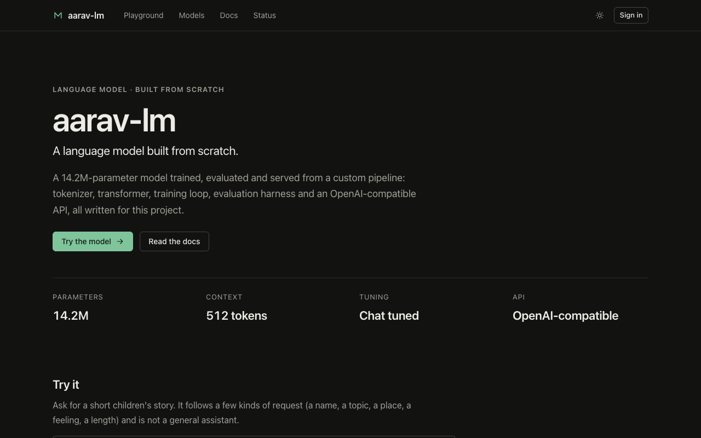
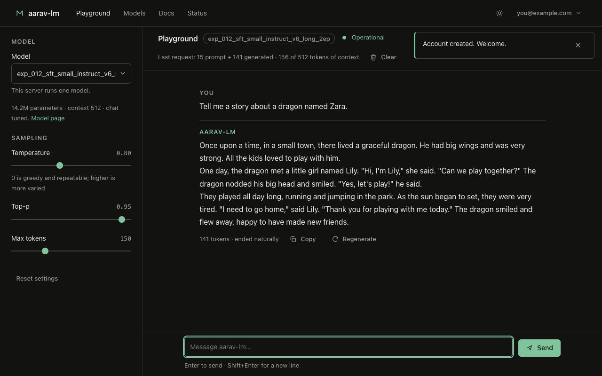
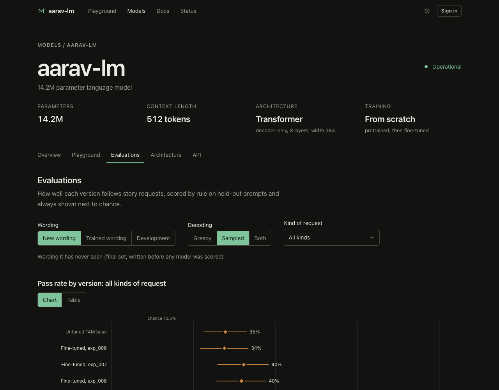

# AARAV-LLM

[](https://github.com/Aaravkhanal/MY-LLM/actions/workflows/tests.yml)

A small decoder-only language model **and the whole stack around it**, built from scratch and run on a
MacBook Air M3 with 8 GB of memory: tokenizer, data pipeline, trainer, evaluation, fine-tuning,
terminal chat, HTTP API and a web chat page.

Nothing here calls an external model or service. The weights are trained in this repository from
random initialisation.

```
$ python chat.py
System: model loaded — 5.0M parameters, context 256, device cpu, tiny-tinystories-v1-sft-int8.pt

You: Tell me a story about Zoe.
Model: Once upon a time, there was a little girl named Zoe. Zoe was very enthusiastic. She loved to
play with her toys in the kitchen. One day, she found a big box in the kitchen. …
```

## Highlights

* **Built from scratch, end to end, on an 8 GB laptop.** A byte-level BPE tokenizer, a Llama-style transformer (RoPE, RMSNorm,
  SwiGLU, grouped-query attention, KV cache), a trainer whose resume is bit-for-bit identical to an uninterrupted run, SFT and LoRA,
  and two trained models (5M and 14M parameters; the 14M one on 103M tokens). No pretrained weights, no external model calls.
* **Evaluation you can trust, and the receipts.** Every score sits next to chance level and a confidence interval, models are
  compared on identical prompts, and the final test set was committed before any model was scored on it. Seven scientific problems
  in the project's own pipeline were found, fixed and tested (a subset-noise validation loss, an unweighted loss under masking, a
  metric that hid two different failures, a diagnostic that crashed a run, ...), and negative results are reported as such
  ([CORRECTNESS.md](docs/CORRECTNESS.md), [RESULTS.md](docs/RESULTS.md)).
* **Serves other people.** An OpenAI-compatible API (checked with the official `openai` SDK), accounts with self-service API keys,
  per-key limits, usage records that never store prompts, request timeouts, and **exact batched decoding** so concurrent users share
  each model step (outputs verified identical to running each alone). Backups and a load tester included
  ([PLATFORM.md](docs/PLATFORM.md), [HOSTING.md](docs/HOSTING.md), [API.md](docs/API.md)).
* **A developer platform around it:** landing page with a live demo, a full-page playground, model card, evaluation dashboard, architecture page
  read from the running model, API docs whose examples were run against a live server, a dashboard with keys and usage, and a status page. Dark,
  restrained, no blue or purple; tests enforce the design rules and contrast ratios, and a real browser drove every route and failure state
  ([PLATFORM.md](docs/PLATFORM.md), [UI_REDESIGN.md](docs/UI_REDESIGN.md)).
* **Engineering discipline.** 558 tests, CI on every push, a script that re-runs CI on a fresh clone (it caught a real production bug
  before it shipped), and honest limits stated everywhere: this is a small story model, not a general assistant.

## What was built, and what came out

Two models have been trained from random initialisation on the M3, each with the same pipeline:

| | `tiny` (v1) | `small` (v2) |
|---|---|---|
| **Model** | 4.95M-parameter Llama-style transformer (RMSNorm, RoPE, SwiGLU, grouped-query attention, tied embeddings) | **14,162,304** parameters, same design: 8 layers, width 384, 6 query / 2 KV heads |
| **Context / vocabulary** | 256 / 2,048 | 512 / 4,096 |
| **Tokenizer** | Byte-level BPE trained here on the training split only; versioned by SHA-256 | same method; 3.96 characters per token on the corpus |
| **Data** | 60 MB of TinyStories → 15.8M training tokens | ~400 MB → **103.0M training tokens** (507,597 stories) |
| **Pretraining** | 3,000 steps, 49.2M tokens (3.1 epochs), **79 min** | 5,500 steps, 90.1M tokens (0.87 epoch), **4.1 h** |
| **Validation loss** (full split, ± std. error) | 7.66 → **1.642** (perplexity 5.17) | 8.43 → **1.395 ± 0.007** (perplexity 4.03); test 1.406 ± 0.007; 0.51 bits per byte |
| **Probes** (55 minimal pairs, chance 50%) | 92.7% | 94.5% |
| **Size** | 19.8 MB fp32, **5.06 MB int8** (+0.01% loss) — packaged in `models/` | 54 MB fp32 (not packaged yet) |

Around them: SFT and LoRA fine-tuning, an evaluation suite with a regression gate, terminal chat, an
HTTP API with hashed keys and rate limiting, and a web platform. **558 pytest tests** (run in CI on every push) plus a 12-check
end-to-end smoke test (~10 s).

Token counts are not parameter counts: the corpus is 103M *tokens*, the model 14.2M *parameters*
(about 6.4 tokens seen per parameter; loss was still falling when training stopped).

### How good is it, honestly?

The base models write fluent, grammatical, well-formed children's stories (`tiny`: 98% of sentences
capitalised correctly, ~0% non-words, 80% of stories end by themselves; the character named in the
prompt was reused in all 20 name prompts). On 55 held-out probes `tiny` scores **92.7%** and `small`
**94.5%** (grammar, story logic, common sense; chance is 50%).


They are also very small models. Story logic drifts ("the pillow was not a pillow"), names and
pronouns sometimes disagree, greedy decoding loops in 12.5% of `tiny` samples (sampling: 0%), and
common-sense facts are shaky. Each knows one domain. **It is not a general assistant**: it has no world
knowledge and cannot reason, summarise, answer questions, write code or do maths.

**Instruction following is the open problem, and it is measured carefully.** Requests are scored by rule (name present, at most
90 words, has dialogue, ...) on held-out stories, always next to *chance* (a story that ignores the request passes 10.6% of the time)
and with paired confidence intervals. The fine-tuned models follow requests worded like their training data far better than the
untuned model (in-template: 64% for exp_009 and 62% for exp_007 vs 42% untuned; for exp_007 names 92%, topics 92%, emotions 96%,
places 79%), but on **entirely new wording** the
gain is modest and not statistically established: on a final evaluation set written before any model was scored on it, the
best models pass 46–48% (greedy) against 40% untuned and 10.5% chance. Length control, learned by memorising three phrasings in the
first attempt, was lost when the data became more varied. Along the way: fixing memorisation was worth +8.7 points (p = 0.002), the
data changes that make a story dwell on what was asked for raised topic requests from 62% to 88%, and three further data
experiments landed inside the evaluation's noise. I then tested the obvious next lever, a better base model: 147M more tokens of
pretraining cut full-split validation loss from 1.404 to 1.288 (22 standard errors), yet the same fine-tuning recipe on it followed
unseen wording no better (44.4% vs 46.5%, paired +2.1 [-6.8, +10.9]) and lost length control entirely, which I first read as "the base is not the
lever". Then a second fine-tuning epoch on that base (exp_012) brought `long` requests back (21% to 79%) and gave the first sampled-decoding
gain over the untuned model on unseen wording (+9.4 points, interval [+0.3, +18.0] on the final set; +14.2 [+6.2, +22.2] on the dev set), while
still leaving the fine-tuned models statistically tied with each other. The earlier reading was too strong, and RESULTS.md says so. The details, including the negative results and the numbers that don't flatter the model, are in
[docs/RESULTS.md](docs/RESULTS.md); how the evaluation itself was made trustworthy is in [docs/CORRECTNESS.md](docs/CORRECTNESS.md);
the full audit and plan are in [docs/AUDIT.md](docs/AUDIT.md).

## Quick start

```bash
# 1. environment (a repo-local venv that reuses your torch install; nothing global is touched)
python -m venv --system-site-packages .venv && .venv/bin/pip install -e ".[api,data,dev]" --no-deps
#    (needs torch, numpy, tokenizers, pyyaml, psutil; fastapi/uvicorn/pydantic for the API)

# 2. is everything fundamentally working?  (~10 s, no downloads, no real data)
python tests/smoke_test.py            # add --mps to also run a few steps on the Apple GPU
scripts/ci_local.sh                   # what CI runs, on a fresh clone in a clean venv (run before pushing)

# 3. chat with the packaged model straight away
python chat.py                                                    # newest experiment, else the packaged SFT model
python chat.py --checkpoint models/tiny-tinystories-v1-int8.pt    # base model: continues your text
```

### Train it yourself

```bash
# data: first 60 MB of TinyStories (curl command in docs/DATASETS.md)
python scripts/prepare_data.py --config configs/tiny_tinystories.yaml      # tokenizer + shards + manifest
python scripts/train.py        --config configs/tiny_tinystories.yaml      # ~80 min; Ctrl-C is safe
python scripts/train.py        --resume experiments/exp_001_tiny_tinystories
python scripts/evaluate.py     --checkpoint experiments/exp_001_tiny_tinystories/checkpoints/best.pt

# fine-tune it into a chat model
python scripts/make_story_requests.py --stories data/raw/tinystories_v2_head.txt --out data/raw/story_requests_v1.jsonl
python scripts/prepare_sft.py  --config configs/sft_tinystories.yaml
python scripts/train.py        --config configs/sft_tinystories.yaml

# the 14M `small` model (needs ~400 MB of TinyStories in data/raw/, see docs/DATASETS.md; ~4 h)
python scripts/prepare_data.py --config configs/small_tinystories.yaml
python scripts/train.py        --config configs/small_tinystories.yaml

# verifiable instruction data + a held-out request-following eval, then SFT
python scripts/make_instruct_data.py --stories data/raw/tinystories_v2_400mb.txt \
    --out data/raw/instruct_v3.jsonl --eval-out evals/instruct_v3.jsonl --n-train 60000 --per-kind 24
python scripts/prepare_sft.py  --config configs/sft_small_instruct_v3.yaml
python scripts/train.py        --config configs/sft_small_instruct_v3.yaml
python scripts/evaluate.py     --checkpoint experiments/exp_006_sft_small_instruct_v3/checkpoints/best.pt \
    --instruct evals/instruct_v3.jsonl

python scripts/audit_dataset.py --source data/raw/tinystories_v2_400mb.txt   # train/held-out overlap, junk, lengths
python scripts/plot_run.py experiments/exp_004_small_tinystories   # loss / perplexity / LR / gradient-norm curves (pip install -e ".[plots]")
python scripts/compare.py                        # side-by-side report of every experiment
python scripts/export_int8.py --checkpoint …     # 3.9x smaller checkpoint
python scripts/benchmark.py                      # throughput and memory on your machine
```

Any config value can be overridden on the command line: `train.lr=5e-4 train.max_steps=500`.

### Serve it, with accounts and a web app

```bash
python scripts/manage_keys.py user add you@example.com --password
AARAV_SIGNUP_CODE='an-invite-code' python scripts/serve.py --db secrets/accounts.db      # http://127.0.0.1:8000
```

People sign up with the invite code, use the playground, create their own API keys and see their usage; the same server is an
OpenAI-compatible API. Add `--public-demo` to let visitors try the model on the home page without an account (rate limited, off by default).
The interface is a small developer platform: landing page, playground, model pages with the evaluation dashboard and architecture, documentation,
dashboard and status. It is dark and restrained, with one green and no blue or purple (tests enforce it). See [docs/PLATFORM.md](docs/PLATFORM.md)
and, for putting it online, [docs/HOSTING.md](docs/HOSTING.md).



| | |
|---|---|
|  |  |

### Serve it (simplest)

```bash
python scripts/create_key.py --label laptop            # key shown once; only its hash is stored
#   or accounts with per-key limits, revoke/rotate and usage records:  scripts/manage_keys.py ...  +  serve.py --db secrets/accounts.db
python scripts/serve.py --checkpoint models/tiny-tinystories-v1-sft-int8.pt
#   web app   http://127.0.0.1:8000/     native API: /health /model /stats /generate /chat  (+ "stream": true)
#   OpenAI-compatible: /v1/models /v1/completions /v1/chat/completions -> works with the `openai` SDK (docs/API.md)
python scripts/serve.py --no-auth                      # localhost only, no key
```

## Terminal chat commands

`/help` `/clear` (forget the conversation) `/reset` (also clear system prompt and settings)
`/save [file]` `/load [file]` `/stats` `/system <text>` `/set temperature|top_k|top_p|max_tokens|repetition_penalty|seed <v>` `/exit`

## Repository layout

```
src/aarav_lm/
  config/      typed model + experiment configs (YAML, dotted overrides, strict type coercion)
  tokenizer/   byte-level BPE, special tokens, fingerprinting, injection-safe encoding
  data/        ingest · clean · dedup · split · token shards · packed batching · SFT conversations
  model/       RMSNorm · RoPE · SwiGLU · GQA attention · KV cache · AaravLM
  train/       trainer · checkpoints · schedule · monitoring · SFT trainer
  finetune/    LoRA (apply, train, merge)
  evaluation/  loss · text metrics · probes · edge cases · suite · regression · comparison
  inference/   engine (streaming, sampling, stop sequences) · chat template · int8 quantisation
  chat/        session + terminal UI            api/  FastAPI app, keys, rate limiter
  web/         the web app (pages, components, styles; no build step)
configs/  evals/  scripts/  tests/  docs/  models/  artifacts/  experiments/
```

## What is in the box

* **Reproducible training.** One seed governs weight init and data order. Resuming from a
  checkpoint — including after Ctrl-C — reproduces the uninterrupted run **bit for bit**; the tests
  prove it, and prove they fail if the optimizer or data-position state is not restored. Checkpoints
  are written atomically and refuse to store NaN weights.
* **Safe by construction.** Checkpoints load with `weights_only=True` (no code execution). User text
  can never become a control token. The API stores only hashed keys, rate-limits, caps sizes, bounds
  its queue, and serves the web page under a strict CSP.
* **Honest evaluation.** No judge model, so quality is measured with checkable proxies (documented as
  such in `evaluation/metrics.py`): held-out loss/perplexity/bits-per-byte, forced-choice probes,
  repetition and loop detection, entity consistency, non-word rate, 14 edge cases. The evaluation
  sets are versioned and hashed into every result, and the regression check refuses to compare
  results from different data, tokenizers or settings.
* **Training diagnostics.** Per-layer gradient norms, loss and gradient-spike detection and an
  overfitting check run alongside training without touching it (bit-identical weights, tested); anomalies
  land in `metrics.jsonl`, the log and `summary.json`. Scientific problems found in the pipeline, with
  evidence and fixes, are logged in [docs/CORRECTNESS.md](docs/CORRECTNESS.md).
* **Independent review.** A separate reviewer with no stake in the code found nine real bugs (the
  worst: the web UI's Stop button could wedge the model lock); each is fixed with a regression test.
  See the commit history.

## Hardware notes (8 GB M3)

Details and measurements in [docs/PERFORMANCE.md](docs/PERFORMANCE.md). The short version: training
runs at ~18k tokens/s in ~1.3 GB of GPU memory; **bf16 was not faster than fp32**; **CPU decodes this
model 5× faster than the GPU** (so inference defaults to CPU below 50M parameters); the fanless Air
throttles, so measurements vary ±30% and checkpointing often is the right default.

## Documentation

| | |
|---|---|
| [docs/TRAINING.md](docs/TRAINING.md) | the training pipeline, the recipes that were run and why, stability and recovery, hardware notes |
| [docs/EVALUATION.md](docs/EVALUATION.md) | how quality is measured: chance level, controls, paired comparison, what each number can and cannot say |
| [docs/AUDIT.md](docs/AUDIT.md) | audit of the whole project: architecture, model and dataset reports, gap matrix, risk register, phased plan |
| [docs/CORRECTNESS.md](docs/CORRECTNESS.md) | running log of scientific problems found in training/evaluation: evidence, fix, test, what is still unmeasured |
| [docs/RESULTS.md](docs/RESULTS.md) | every experiment, what worked, what didn't |
| [docs/MODEL_CARD.md](docs/MODEL_CARD.md) | what the 14M model is: architecture, data, training, results, limits, intended use |
| [docs/ARCHITECTURE.md](docs/ARCHITECTURE.md) | design decisions and why, checkpoint format, data flow |
| [docs/PERFORMANCE.md](docs/PERFORMANCE.md) | measured throughput, memory, int8, thermal behaviour |
| [docs/PLATFORM.md](docs/PLATFORM.md) | the web app and accounts: sign-up, chat, self-service API keys, usage; the design rules (minimal, no blue or purple) and how they are tested |
| [docs/HOSTING.md](docs/HOSTING.md) | putting it online for other people: options, capacity, Docker + HTTPS files, backups, a pre-launch checklist |
| [docs/API.md](docs/API.md) | the HTTP API as it exists today: endpoints, fields, errors, streaming |
| [docs/SECURITY.md](docs/SECURITY.md) | controls that exist, known gaps, what must close before going public |
| [docs/DEPLOYMENT.md](docs/DEPLOYMENT.md) | plan for serving other people (design only; nothing deployed) |
| [docs/DATASETS.md](docs/DATASETS.md) | data sources and licences |
| [docs/THIRD_PARTY.md](docs/THIRD_PARTY.md) | works that informed the design |
| [models/README.md](models/README.md) | the packaged checkpoints |

## Scaling path and what is not built

The `small` preset is trained (above), and its pretraining has been extended once: 237M tokens in all (exp_010), about 0.9 GB of text and
roughly 40% of the 2.2 GB TinyStories file (at 3.96 bytes per token, from the measured bits per byte). That was the "cheapest next gain" for language modelling (validation loss 1.404 to 1.288), and it helps request following only once fine-tuning
runs about two epochs (exp_011 vs exp_012). What is untested: instruction data
that teaches length explicitly and stays varied, and a larger model. On 8 GB, roughly
30-50M parameters is the practical ceiling for pretraining; anything larger needs rented GPU time.

Serving many users at once: `--batch-size N` decodes concurrent requests together (exact; tested against solo generation). Not built: email verification and password reset, preference tuning (DPO), continuous
batching, real int8 kernels, multi-GPU training, cloud deployment. The order they will be tackled in,
and what has to be true first, is in [docs/AUDIT.md](docs/AUDIT.md).

## Licence

MIT (see LICENSE). The training data has its own licence (CDLA-Sharing-1.0, docs/DATASETS.md).
