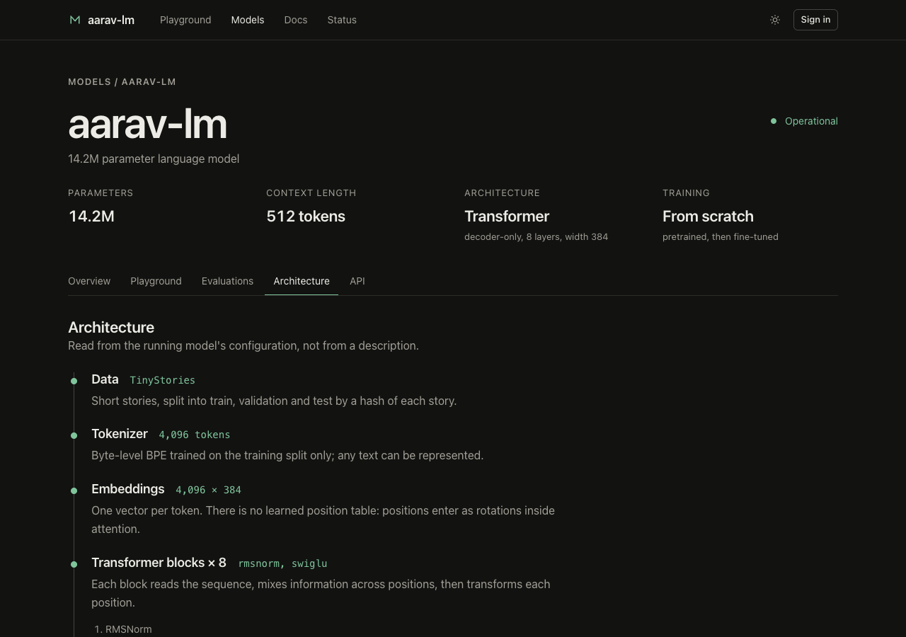
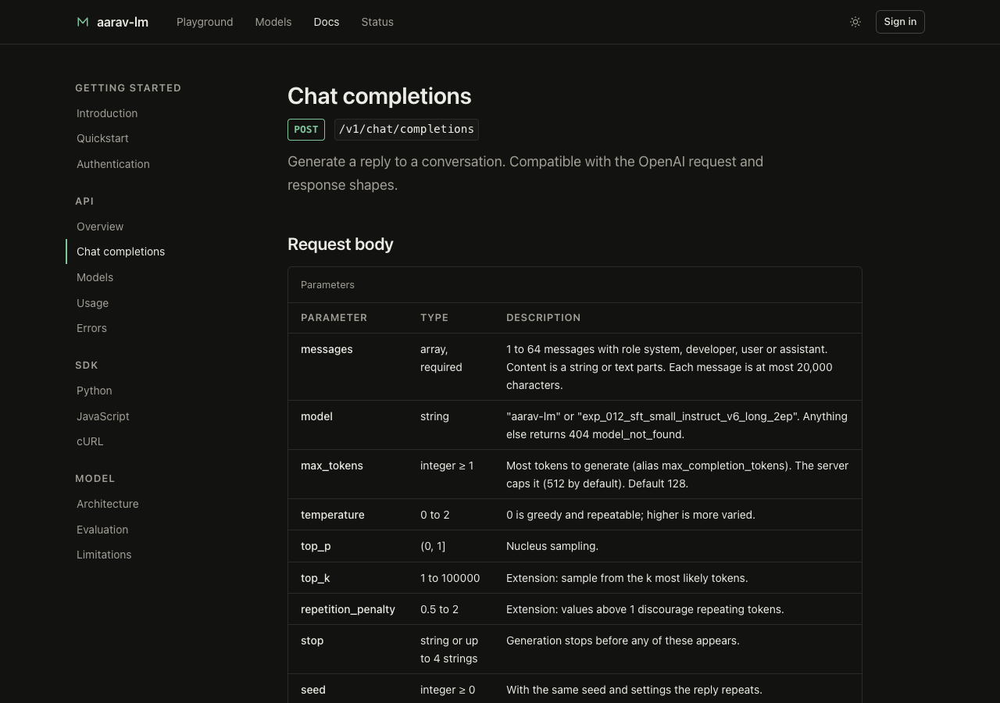
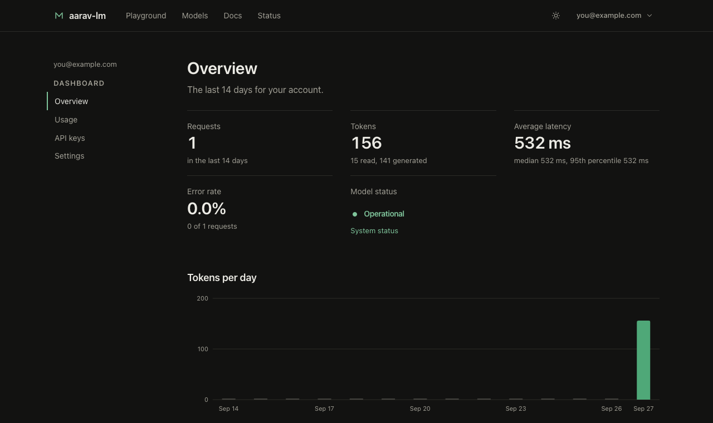
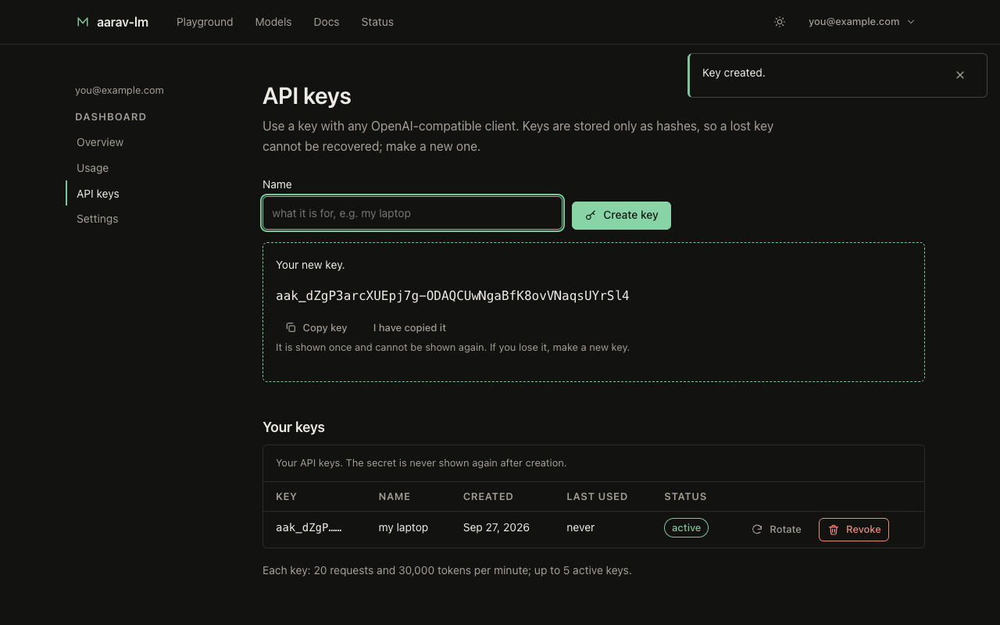
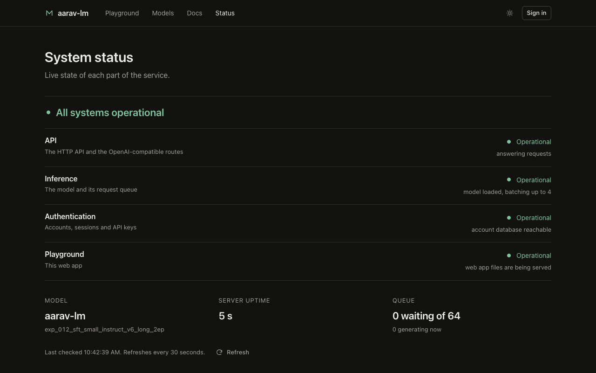
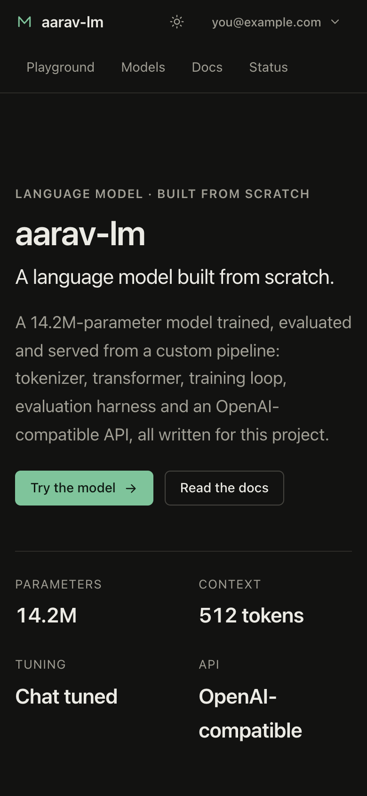

# The platform: accounts, keys and the web app

One process serves the model, the OpenAI-compatible API ([API.md](API.md)) and the web app. With `--db` it also runs
accounts: people sign up, use the playground, create their own API keys and see their usage. How the current interface came
about (audit, decisions, plan) is in [UI_REDESIGN.md](UI_REDESIGN.md).

```bash
python scripts/manage_keys.py user add you@example.com --password       # the owner's login
AARAV_SIGNUP_CODE='choose-an-invite-code' \
python scripts/serve.py --db secrets/accounts.db --checkpoint <checkpoint> --public-demo
# open http://127.0.0.1:8000
```

| Mode | Started with | What the web app does |
|---|---|---|
| Accounts | `--db` (signup closed, `--signup-code` for invites, or `--open-signup`) | sign in / create account; playground, dashboard, keys, usage |
| Key file | default | asks for one API key (kept in the tab only) in the playground |
| No auth | `--no-auth` (localhost only) | playground without sign-in |

`--public-demo` adds a rate-limited demo on the home page for visitors without an account (below).

## The site

| Page | What it is |
|---|---|
| `/` | Landing: hero, the model's real numbers, a live demo, evaluation summary, how it was built, API tabs, limitations |
| `/playground` | Full-page tool: settings sidebar (model, temperature, top-p, max tokens, advanced), streamed conversation, copy, regenerate, clear, live status, real token counts |
| `/models`, `/models/aarav-lm` | Model list and model card |
| `/models/aarav-lm/evaluations` | Evaluation dashboard: wording set, decoding and kind filters, chart and table, paired comparisons, dataset facts |
| `/models/aarav-lm/architecture` | The pipeline, the running model's configuration, a computed parameter breakdown checked against the model's own count, six expandable sections |
| `/docs/...` | Introduction, quickstart, authentication, API reference (chat completions, models, usage, errors), SDK pages, limitations |
| `/dashboard`, `/dashboard/usage`, `/dashboard/api-keys`, `/dashboard/settings` | Requests, tokens, latency, error rate, status; keys (create, name, rotate, revoke; shown once); password |
| `/status` | Per-service state from the server's own checks |
| `/signin` | Sign in and create account |


| | |
|---|---|
|  |  |
|  |  |
|  |  |
|  |  |

Every number on these pages is read from the running server or from `results.json`, which `scripts/build_site_data.py` generates from the
committed evaluation and run files (a test rebuilds it and fails if the committed file differs). Nothing is typed in by hand; where a
value is unknown the page shows a dash, and where the server cannot be reached it says so instead of showing a healthy state.

**The public demo** (`--public-demo`, off by default). One short prompt (up to 300 characters), streamed, no account. Limits: a burst of three then
`--demo-per-minute` (default 6) per client address, output capped (120 tokens), sampling fixed. It goes through the same queue as everyone
else, is never written to the usage table (there is no user to attribute it to), and is off unless the owner turns it on.

**Status** (`/status.json`, public, no user data). API: the process is answering. Inference: the batch-scheduler thread is alive, the request queue is
under its limit, and failures since start are under 20%. Authentication: a round trip to the account database. Playground: the web files are being
served. It checks from inside the process, so it cannot see a crashed server; the page then says it cannot reach the server. It keeps no history.

## Architecture of the front end

No build step and no libraries: ES modules served as static files, drawn with DOM calls and `textContent`, never HTML strings. Pages are
lazy-loaded modules behind a small History-API router; the server answers a fixed list of page paths with one HTML shell (anything else is a real
404) and compresses the static files once at start-up (gzip; the home page is about 47 KB compressed). The component library is in
`web/js/ui.js` (buttons, badges, code blocks with an in-house highlighter, tabs, tables, form controls, menu, dialog, toast, skeleton, accordion) and
`web/js/charts.js` (responsive SVG charts with a table alternative).

## Design rules (enforced by tests)

Dark, near-black and restrained: off-white text, one subtle green, thin borders, generous spacing, subtle motion. Sections are unboxed (type,
whitespace, hairlines); an element gets an edge only where a control needs one (inputs, code blocks, tables, dialogs), with a single 6-pixel radius.
No shadows, gradients or blur. **There is no blue and no purple anywhere.** A light theme is one click away and remembered.

`tests/test_web_design.py` reads the real files and fails if: any colour has a hue between cyan and magenta; neutrals are not warm; any text
colour is below WCAG AA on its surface (including code tokens on the code background and the label on the primary button); the chart colours are not the
ones that passed the palette validator (dark `#4fa878` and `#c4803f` on `#121211`; light `#2f8558` and `#a8611f` on `#fcfcfb`; their colour-blind
separation is a warning that the charts answer with marker shapes and labels); a colour appears outside `css/tokens.css` or in the JavaScript; a shadow,
gradient, blur, stray radius or card-like class appears; an icon-only button has no accessible name; motion is long or ignores the reduced-motion setting.

Other properties: keyboard focus is always visible; a skip link; focus moves to the page after navigation and the change is announced; arrow keys, Home and End in
tab strips; a menu with Escape and arrow keys; native dialogs (focus trapped, Escape closes and returns focus); labelled fields; `aria-live` for streamed replies and errors. The page
loads nothing from any other host (strict CSP: `default-src 'none'`, scripts and styles from the same origin only), and no server or model text is ever
inserted as HTML (there is no `innerHTML` anywhere; a test enforces it).

## How it was tested

Unit and route tests (`tests/test_web_routes.py`, `test_web_design.py`, `test_site.py`, `test_demo.py`) cover the page list, the asset map, status truth,
compression, the demo's limits, design rules, and that the client router and the server list are the same list. A real Chrome then drove every route at 390, 768 and
1280 pixels in both themes (no console errors, no horizontal overflow, no broken internal links), and the flows: sign-up, streamed chat, regenerate, clear,
key create/rotate/revoke, the demo and its rate limit, the degraded/outage/unreachable status states, a 503, a 429, a network failure and a raw-traceback 500 (never
shown), loading skeletons, error states, and keyboard-only use of the menu, tabs, accordion and dialog. Every documented API example was run against a live
server (cURL, the Python SDK and Node, plain and streamed). That run found bugs no unit test would have: a chat error banner that was erased the instant it
appeared, table cells printing `[object HTMLSpanElement]`, arrays stringified by `replaceChildren`, and a toast covering the Send button.

## Account security

* Passwords: salted scrypt, 10-128 characters, never returned or logged; a wrong email takes as long as a wrong password.
* Sign-in and signup are rate limited per client and per email; signup needs an invite code unless the owner opens it
  (email verification would need an email service, so the invite code is the abuse control).
* Sessions: an HttpOnly, SameSite=Strict cookie (Secure over HTTPS), 7 days, only its SHA-256 stored; every state-changing
  request must carry the session's CSRF token; changing the password signs out every other device.
* Keys: only a hash is stored; other people's keys look exactly like missing ones (404); at most 5 active per user, each
  with conservative default limits (20 requests and 30,000 tokens per minute).
* Details and the remaining gaps: [SECURITY.md](SECURITY.md).

## Serving other people

See [HOSTING.md](HOSTING.md).
