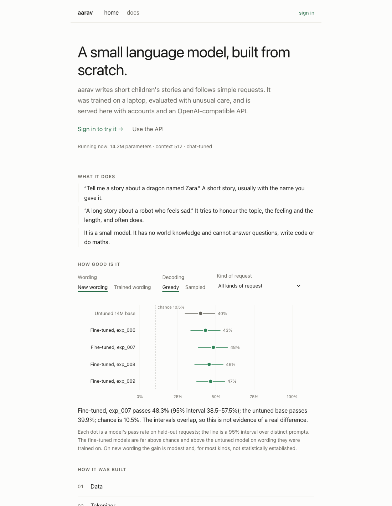
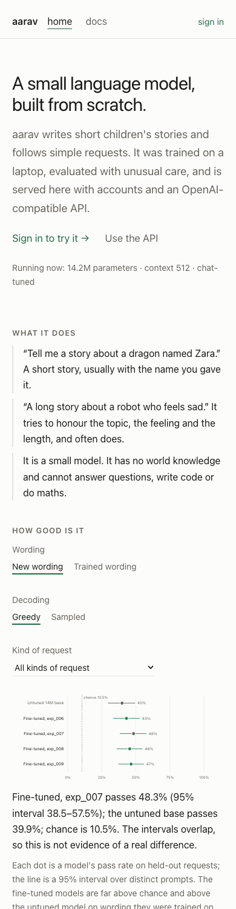
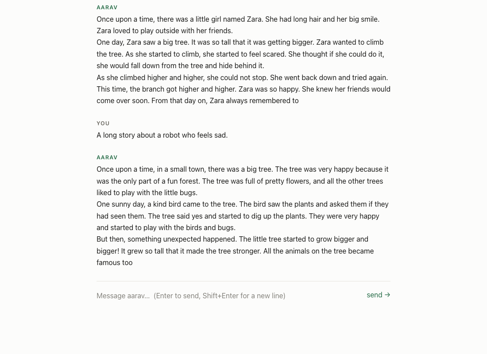
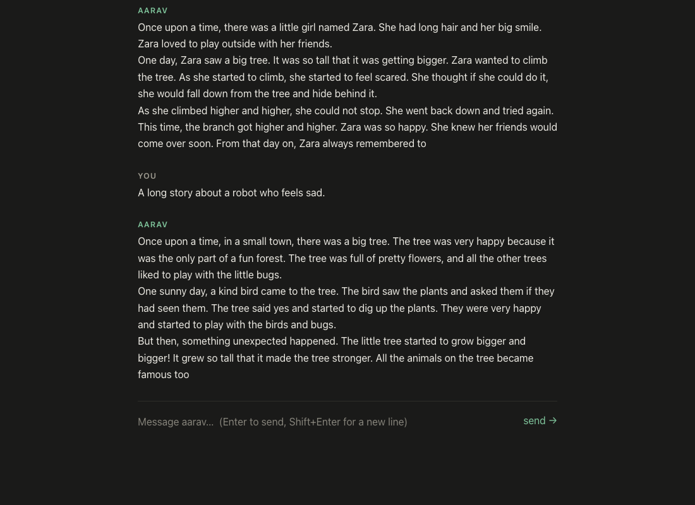
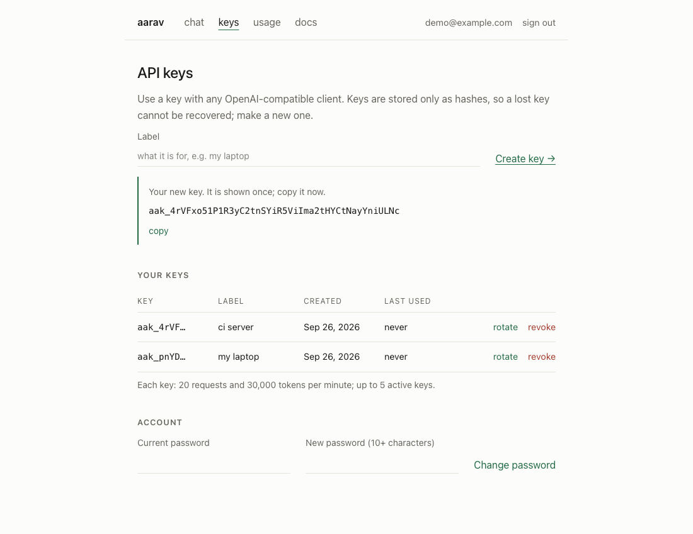
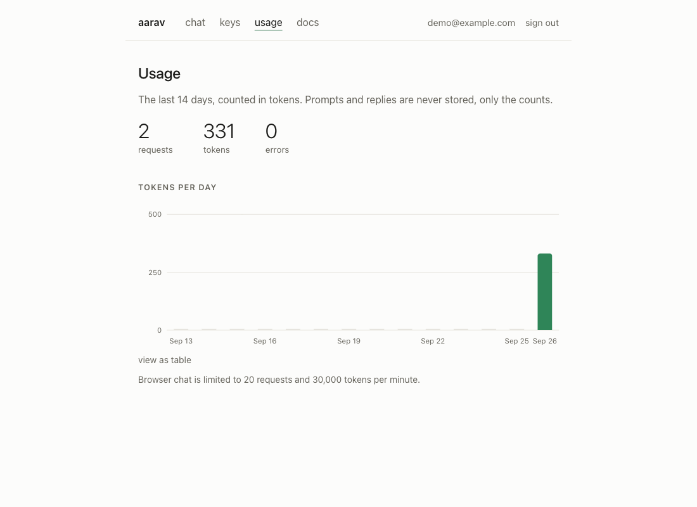

# The platform: accounts, keys and the web app

One process serves the model, the OpenAI-compatible API ([API.md](API.md)) and a small web app. With `--db` it also runs
accounts: people sign up, chat in the browser, create their own API keys and see their usage.

```bash
python scripts/manage_keys.py user add you@example.com --password       # the owner's login
AARAV_SIGNUP_CODE='choose-an-invite-code' \
python scripts/serve.py --db secrets/accounts.db --checkpoint models/tiny-tinystories-v1-sft-int8.pt
# open http://127.0.0.1:8000
```

| Mode | Started with | What the web app does |
|---|---|---|
| Accounts | `--db` (signup closed, `--signup-code` for invites, or `--open-signup`) | sign in / create account; chat, keys, usage, docs |
| Key file | default | asks for one API key (kept in the tab only); chat and docs |
| No auth | `--no-auth` (localhost only) | chat and docs |

## The website

The front page is public (no sign-in) and is itself interactive:

| | |
|---|---|
|  |  |

* **Results explorer.** Pick which wording (new or trained), decoding (greedy or sampled) and kind of request; every model appears with its
  95% interval and the chance level, plus a one-sentence reading generated from the numbers (it says when intervals overlap and
  warns when a kind has fewer than ten distinct prompts). The data is `src/aarav_lm/web/results.json`, generated from the evaluation
  files by `scripts/build_site_data.py`; a test rebuilds it and fails if the committed file differs.
* **How it was built:** six steps that open on click, one at a time. **Use it from code:** curl / Python / JavaScript tabs (arrow
  keys work), each with a copy button. **What is stored** and **Honest limits** are stated in plain words.
* A line at the top states what is running right now (parameters, context, chat-tuned), read from the server.

## What you see

Chat (light and dark) and the keys and usage pages, in the real app:

| | |
|---|---|
|  |  |
|  |  |

The chat streams real tokens as the model produces them (nothing is faked or delayed), can be stopped, and keeps its history
in the page only. Keys are shown once, then only their prefix is listed; each can be rotated or revoked. Usage shows counts
per day, never prompts or replies, as a chart with hover values and a "view as table" alternative.

## Design rules (enforced by tests)

Minimal, and no boxes: the app uses type, whitespace and one-pixel hairlines. There are no cards, panels, shadows or rounded
corners, and no filled backgrounds. Colour is warm neutrals with a single green; **there is no blue and no purple anywhere**.

`tests/test_web_design.py` reads the real stylesheet and fails if: any colour has a hue between cyan and magenta; the neutrals
are not warm; any text colour is below WCAG AA (4.5:1) on its background in either theme; the chart colour is not the one
that passed the palette validator (`#2f8558` on `#fcfcfb`, `#4fa878` on `#1a1a19`: lightness band, chroma floor and 3:1 contrast
all pass); a shadow, radius, tinted background or all-sides border appears; the JavaScript contains a colour literal.

Other properties: light and dark follow the system setting; keyboard focus is always visible; a skip link; labelled fields;
`aria-live` for streamed replies and errors; reduced-motion respected; usable at phone width. The page loads nothing from any
other host (strict CSP: `default-src 'none'`, scripts and styles from the same origin only), and no server or model text is
ever inserted as HTML (there is no `innerHTML` anywhere; a test enforces it).

The whole flow was driven in a real browser (sign-up, streaming chat, key creation, usage chart hover and table, docs, dark
mode, a phone-width viewport) with no console errors or CSP violations. That run found three bugs that no unit test would have:
a chart bar that swallowed its own hover, a focus ring drawn around the entire page, and nested elements rendered as
`[object HTMLDivElement]`.

## Account security

* Passwords: salted scrypt, 10-128 characters, never returned or logged; a wrong email takes as long as a wrong password.
* Sign-in and signup are rate limited per client and per email; signup needs an invite code unless the owner opens it
  (email verification would need an email service, so the invite code is the abuse control).
* Sessions: an HttpOnly, SameSite=Strict cookie (Secure over HTTPS), 7 days, only its SHA-256 stored; every state-changing
  request must carry the session's CSRF token; changing the password signs out every other device.
* Keys: only a hash is stored; other people's keys look exactly like missing ones (404); at most 5 active per user, each
  with conservative default limits (20 requests and 30,000 tokens per minute).
* Details and the remaining gaps: [SECURITY.md](SECURITY.md).

## Serving other people

See [HOSTING.md](HOSTING.md).
