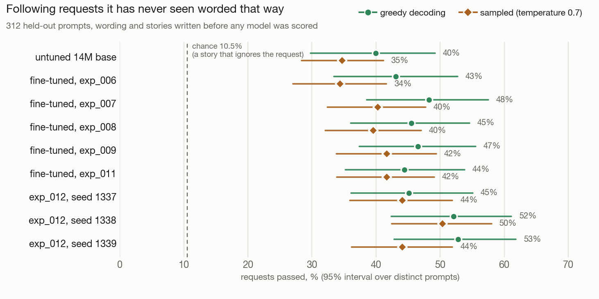

# Results

Everything here was produced by the code in this repository on a MacBook Air M3 (8 GB). Raw records
live in `experiments/exp_00N_*/` (config, environment, every logged metric, evaluation results);
`python scripts/compare.py` regenerates `experiments/COMPARISON.md`.

## Experiments

| | exp_001 | exp_002 | exp_003 |
|---|---|---|---|
| **What** | pretrain from scratch | SFT (600 steps) from exp_001 | SFT (2,000 steps) from exp_001 |
| Data | TinyStories 60 MB slice, 15.8M train tokens | 19.8k story-request conversations | same |
| Steps / tokens | 3,000 / 49.2M (3.1 epochs) | 600 (≈1 epoch) | 2,000 (≈3.2 epochs) |
| Wall time | 79 min | 6.5 min | 24.8 min |
| Val loss / perplexity | **1.642 / 5.17** (7.66 at init) | 1.421 / 4.14 (chat format, assistant tokens) | 1.441 / 4.22 |
| Best step | 3,000 (still improving) | 600 | **1,750** (then overfits) |
| Next-token top-1 / top-5 | 59.4% / 84.1% | 63.6% | – |
| Probes (55 pairs, chance 50%) | **92.7%** | 87.3% | 87.3% |
| Edge cases | 14/14 | 14/14 | 14/14 |

The SFT loss values are not comparable to pretraining's: they are measured only on assistant tokens
of templated story requests, which are easier to predict than raw stories.

## Pretraining (exp_001)

* Validation loss fell at every one of 12 evaluations (2.66 at step 250 → 1.64 at step 3,000), with
  no divergence between training loss (1.54) and validation loss (1.64) after 3 epochs. It was still
  improving, so more steps or more data would help. Test loss (1.627) agrees with validation.
* Bits per byte: 0.651 (val), 0.640 (test) — the tokenizer-independent number to compare against
  other models.
* Generation quality (40 fixed prompts; full data in `experiments/exp_001…/eval/best_results.json`):

| | greedy | sampled (T=0.8, top-k 50, top-p 0.95) |
|---|---|---|
| Sentences correctly capitalised | 97.8% | 97.3% |
| Non-word rate | 0.0% | 0.1% |
| Samples containing a degenerate loop | **12.5%** | 0% |
| distinct-2 (repetition; higher is more varied) | 0.37 | 0.54 |
| Stories ending on their own | 80% | 80% |
| Prompt character reused (20 name prompts) | 100% | 100% |
| Mean length | 139 tokens | 140 tokens |

* Probes: grammar 26/26, story logic 10/10, common sense 15/19. The four misses: "Ice is very
  **cold**" (chose *hot*), "We smell with our **nose**", "Snow is **white**", "An ant is very
  **small**".

Typical output (greedy, prompt in bold):

> **Once upon a time, there was a little girl named Mia.** Mia loved to play with her toys. One day, she found a big box in her room. She was very happy and wanted to see what was inside. Mia opened the box and found a big, soft pillow. […] But when she woke up, she saw that the pillow was not a pillow.

Fluent and structurally right; the plot logic breaks down at the end, which is what this size does.

## Fine-tuning (exp_002, exp_003)

What worked:

* The model learned the chat template and stops replies itself with `<|end|>`. That is a change of
  mechanism, not of rate: replies end on their own 80–93% of the time, about the same as the base
  model's `<|endoftext|>` endings (77–93%).
* Named characters get **consistent genders** (the base model wrote "a little girl named Tom").
* Names never seen in training ("Zoe", "Ruby") work.

What did not:

| Requested name/topic word reused (25 prompts: 15 names, 10 topics) | greedy | sampled |
|---|---|---|
| Base model, request as plain text | 0.68 | 0.84 |
| SFT, 600 steps | 0.72 | 0.76 |
| SFT, 2,000 steps | 0.88 | 0.84 |

* Asking for a story **with a dragon** often returns a story about a boy. Reuse of the requested
  topic word is not distinguishable from the base model given the same text (65% vs 68% over 60
  samples in an ad-hoc check; 0/3 for "robot", "park", "cake").
* With 25 prompts, a 5-prompt difference (0.68 → 0.88) is **not statistically meaningful**. Only the
  greedy improvement for exp_003 is suggestive, and it does not appear when sampling.
* Longer SFT overfits after ~1,750 steps (val loss 1.470 → 1.477) and costs common-sense probes
  (92.7% → 87.3%): a little forgetting.
* Why it is weak: the requests are templated, the "topic" label is the first matching keyword in the
  story's opening, and a 5M-parameter model has little capacity to condition 150 tokens of story on a
  short request. The packaged SFT model is the 600-step one (lower loss, less forgetting).

## The 14M model and request following (exp_004 – exp_006)

Everything in this section is reproducible from the repository: configs in `configs/`, per-run records in
`experiments/exp_00{4,5,6}_*/`, evaluation files in `evals/`, scripts named below.

### Pretraining the `small` model (exp_004)

14,162,304 parameters (8 layers, width 384, 6 query / 2 KV heads, context 512, vocabulary 4,096), 5,500 steps,
90.1M tokens (0.87 epoch of the 103M-token training split), 4.09 h on the M3.

| Held-out split (scored in full) | Loss ± std. error | Perplexity | Bits per byte | Top-1 |
|---|---|---|---|---|
| validation (999 windows) | **1.3948 ± 0.0065** | 4.03 | 0.509 | 0.637 |
| test (995 windows) | 1.4056 ± 0.0072 | 4.08 | 0.513 | 0.634 |

Bits per byte is the tokenizer-independent number: exp_001 (the 5M model, a different tokenizer) had
0.651 on its validation split, so the 14M model is about 22% better. Probes 94.5% (55 pairs, chance 50%), edge
cases 14/14. Training was healthy (no NaN, no loss spikes; one isolated gradient spike absorbed by clipping,
see [CORRECTNESS.md](CORRECTNESS.md), entry 4) and train and validation loss overlap throughout: no overfitting,
and both were still falling when it stopped.

### Instruction tuning: what the data taught, measured properly

Two SFT runs of exp_004 on 60,000 verifiable conversations each: **exp_005** (each length or dialogue request
had 2–3 phrasings) and **exp_006** (70–84 phrasings each; recipe otherwise identical). Request following is
scored by rules, not by a judge (`evaluation/instruct.py`): a reply passes if it satisfies every check, e.g. "contains
the requested name", "at most 90 words", "has dialogue".

Two prompt sets, both built from held-out (test-split) stories, 24 prompts for each of 13 request kinds:

* **held-out phrasings** (`evals/instruct_v3.jsonl`): request wording never used in training; for name requests,
  half use names that never occur in the corpus.
* **in-template control** (`evals/instruct_v3.intemplate.jsonl`): the same kinds, but the wording the model *was*
  trained on. The gap between the two sets is what separates "did not learn the task" from "learned only the
  wording it saw".

Every rate is reported next to **chance**: the pass rate of a real story that ignores the request (aggregate
10.6%; per kind below). Confidence intervals resample *distinct* prompts (190 distinct prompts in the held-out
set, 277 in the control), because kinds like "short story" repeat a few strings. Greedy decoding, pass rate %:

| Request kind | chance | base 004 | SFT 005 | SFT 006 | | base 004 | SFT 005 | SFT 006 |
|---|---|---|---|---|---|---|---|---|
| | | **held-out phrasings** | | | | **in-template control** | | |
| dialogue | 66.8 | 96 | 100 | 100 | | 62 | 75 | 100 |
| short | 1.4 | 71 | 0 | 0 | | 46 | 29 | **100** |
| long | 11.6 | 21 | 0 | **58** | | 12 | 21 | **75** |
| name | 3.9 | 46 | 50 | **67** | | 58 | 75 | 79 |
| name + topic | 0.7 | 33 | 38 | 42 | | 29 | 62 | 71 |
| topic | 8.8 | 62 | 42 | 46 | | 75 | 88 | 83 |
| place | 10.2 | 62 | 29 | 21 | | 54 | 33 | 21 |
| emotion | 19.3 | 46 | 50 | 46 | | 58 | 50 | 25 |
| **all scored kinds** | 10.6 | 40.6 | 28.8 | 37.5 | | 41.7 | 44.4 | **56.9** |
| 95% CI of the aggregate | | 30–51 | 20–38 | 27–48 | | 36–48 | 39–50 | 51–63 |

(The base model receives the request as plain text to continue; the SFT models get the chat template.)

Paired comparisons on identical prompts (`scripts/compare_instruct.py`, greedy; difference in points, 95% interval):

| A vs B | held-out phrasings | in-template control |
|---|---|---|
| SFT 006 vs SFT 005 | **+8.7 [+2.8, +15.4], p = 0.002** | **+12.5 [+6.3, +18.5]** |
| SFT 006 vs base 004 | −3.1 [−15.6, +8.7], p = 0.67 (no difference) | **+15.3 [+7.4, +22.8]** |

What this establishes:

* **The phrasing fix worked.** exp_006 beats exp_005 on unseen wording, mostly through length control (long 0 → 58%,
  p = 0.005) and names (+17 points, p = 0.025).
* **The model really learned to follow requests, for wording it saw.** On the in-template control it is far above
  chance and the base model: short 100%, dialogue 100%, long 75%, name 79%, name + topic 71%.
* **It does not generalise to unseen wording.** On held-out phrasings it is indistinguishable from the untuned
  base model overall (and worse on "short": 0% vs 71%; the replies are 91–142 words, i.e. its default length).
  A 14M model trained on ~80 phrasings per kind is learning a template family, not the concept of a request.
* **Content requests (topic, place, emotion) are its weak spot**, worse than the base model even in-template
  (place 21% vs 54%, emotion 25% vs 58%). The base model just continues the prompt text, which repeats the
  requested word; the SFT model opens most stories with the same generic "a little girl named Lily…". The training data
  explains part of it: a place request's story mentions the place late (median 19 words in) and `park` is 40% of
  the 5,114 place examples (`library` 14).
* **Sampling hurts control** (in-template aggregate 56.9% greedy vs 43.1% sampled at T = 0.7).

Losses: validation loss on the *full* split is 1.3190 ± 0.0079 (exp_005) and 1.3185 ± 0.0076 (exp_006), but they are
scored on different conversation sets, so this is **not** a comparison of the two models
([CORRECTNESS.md](CORRECTNESS.md), entry 1). Per-conversation and per-prompt outcomes are in
`experiments/exp_00{4,5,6}_*/eval/`.

### exp_007: the v4 data (content control up, length control lost)

The weak spots above pointed at the data, so exp_007 keeps exp_006's recipe (same base, seed, steps and learning rate) and
changes only the training conversations (`configs/sft_small_instruct_v4.yaml`): 23 request wordings instead of 8, the requested
word must occur at least twice in the story and first appear within 40 words, sampling is balanced across rare places, topics
and names (`park` falls from 40% to 19% of place requests, `library` rises from 14 to 100 examples), and 15% of requests are
typed casually. Its results are also on the **final set**, whose wording and stories no design decision ever saw
(`evals/instruct_v4_final.jsonl`, committed before anything was scored on it). All four models were scored on it once; the
table is complete, not selected. Greedy decoding, pass rate %:

| | | **FINAL set (fresh wording and stories)** | | | | **dev: unseen wording** | | **dev: in-template** | |
| Request kind | chance | base 004 | SFT 005 | SFT 006 | SFT 007 | 006 | 007 | 006 | 007 |
|---|---|---|---|---|---|---|---|---|---|
| dialogue | 66.8 | 83 | 100 | 100 | 100 | 100 | 75 | 100 | 92 |
| short | 1.4 | 67 | 17 | 33 | 17 | 0 | 58 | 100 | 50 |
| long | 11.6 | 0 | 12 | 75 | 0 | 58 | 0 | 75 | 0 |
| name | 6.2 | 29 | 62 | 54 | 67 | 67 | 75 | 79 | 92 |
| name + topic | 0.4 | 25 | 42 | 54 | 67 | 42 | 58 | 71 | 79 |
| topic | 5.7 | 67 | 62 | 62 | 88 | 46 | 67 | 83 | 92 |
| place | 10.2 | 54 | 17 | 17 | 62 | 21 | 58 | 21 | 79 |
| emotion | 19.3 | 42 | 46 | 71 | 83 | 46 | 75 | 25 | 96 |
| **all scored kinds** | 10.5 | 39.9 | 31.9 | 43.1 | 48.3 | 37.5 | 49.3 | 56.9 | 62.2 |
| 95% CI (clustered) | | 30–49 | 23–41 | 33–53 | 39–58 | 27–48 | 39–59 | 51–63 | 57–68 |

Paired differences on identical prompts (greedy; points, 95% interval):

| SFT 007 vs | final set | dev: unseen wording | dev: in-template |
|---|---|---|---|
| SFT 006 | +5.2 [−5.4, +15.3] | +11.8 [−1.0, +25.0] | +5.2 [−2.1, +12.5] |
| base 004 | +8.3 [−3.3, +19.4] | +8.7 [−1.8, +19.3] | – |

With sampled decoding the aggregate gain over exp_006 is +5.9 on the final set ([−0.7, +12.6]), +9.7 on unseen wording
([+3.4, +16.5], p = 0.002) and +13.2 in-template ([+6.7, +19.8], p = 0.001).

What this does and does not establish:

* **Content requests improved a lot, and it holds on the fresh set.** Topic 62 → 88% (paired +25 points, p = 0.002), emotion
  71 → 83% (and 42 → 83% against the base model, p = 0.001), place 17 → 62%, name + topic 54 → 67%. In-template, emotion
  goes 25 → 96% and place 21 → 79%. The changes that target these (a story that dwells on and opens with what was asked for,
  balanced rare values) did what they were designed to do.
* **The overall gain is not statistically established.** On every set the aggregate is higher than exp_006's and the base
  model's, but only the sampled-decoding differences on the development sets have intervals that exclude zero. The final set,
  with 197 distinct prompts, gives +5.2 [−5.4, +15.3] against exp_006 and +8.3 [−3.3, +19.4] against the base model. It is
  reported as "probably better, not proven".
* **It broke length control, even in-template.** `long` fell from 75% to 0% (final set: paired −75 points, p = 0.003) and
  in-template `short` from 100% to 50%. The replies to long requests are 130–150 words, the model's default length. The
  likely cause (a hypothesis, tested by exp_008): with 240 wordings per length kind each wording is seen about 12 times
  instead of 35, so the model no longer memorises the template and does not learn the concept in one epoch.
* **What is still unsolved:** two-topic requests (8%), "short" on unseen wording, and long stories.

### exp_008 and exp_009: the data recipe is at its noise floor

Two more single-change experiments on top of exp_007 (same base, seed, steps and learning rate; only the conversations differ):

* **exp_008** (`configs/sft_small_instruct_v5.yaml`, `--length-boost 3`): length requests sampled three times as often. The
  hypothesis was that many wordings had diluted the length signal. **Not supported.** Greedy `long` stayed at 0% even in-template
  and `short` got worse (in-template 50 → 17%, paired p = 0.009); topic requests on the final set fell (88 → 71%, p = 0.022). Under
  *sampled* decoding a length signal exists (in-template `long` 29 → 54%), so the model has it but greedy decoding falls back to its
  default length. Length control and content control appear to compete for capacity in one epoch at 14M parameters.
* **exp_009** (`configs/sft_small_instruct_v6.yaml`, exp_008's data plus: both words of a two-topic request must be prominent
  and early). Two-topic requests moved the right way (unseen wording 8 → 25%, in-template 42 → 54%) but not significantly, and
  some length control came back in-template (`short` 75%, `long` 21%).

All aggregate pass rates (% of scored requests; chance 10.5–10.6%). The **final set** was scored once per model, so this is the
complete table, not a selection:

| | base 004 | SFT 006 | SFT 007 | SFT 008 | SFT 009 |
|---|---|---|---|---|---|
| **final set**, greedy | 39.9 | 43.1 | 48.3 | 45.5 | 46.5 [37–56] |
| **final set**, sampled | 34.7 | 34.4 | 40.3 | 39.6 | **41.7** [34–49] |
| dev, unseen wording, greedy | 40.6 | 37.5 | 49.3 | 44.4 | **50.3** |
| dev, unseen wording, sampled | 35.1 | 29.9 | 39.6 | 41.3 | **44.8** |
| dev, in-template, greedy | 41.7 | 56.9 | 62.2 | 60.8 | **64.2** |
| dev, in-template, sampled | 45.1 | 43.1 | 56.2 | 58.0 | 56.9 |

(`python scripts/plot_results.py` regenerates this from the result files.)

What the paired tests say:

* **007, 008 and 009 cannot be told apart** on the final set (009 vs 007: −1.7 [−9.5, +5.7] greedy, +1.4 [−4.5, +7.3] sampled; 008 vs
  007: −2.8 [−11.0, +5.3]). The only established difference among them is exp_009 over exp_007 on unseen wording with sampled
  decoding (+5.2 [+0.9, +9.7], p = 0.022) on the development set, which did not repeat on the final set.
* **The v4-family recipes beat exp_006 where it matters.** exp_009 vs exp_006 on the final set: +7.3 [+1.0, +13.7] sampled (p = 0.025),
  +3.5 [−8.4, +14.7] greedy. exp_006's only advantage is length control it had memorised (`long` 75% vs 12.5%, p = 0.028).
* **Against the untuned model** every fine-tuned recipe is ahead by 4–8 points on fresh wording, but with 197 distinct prompts the
  intervals still include zero for greedy decoding (009: +6.6 [−6.2, +19.3]).

So the honest state: the fine-tuned models follow requests clearly better than chance, and far better on wording they were trained
on, but on entirely new wording the gain over an untuned model is modest and not statistically established at this evaluation size.
**Tuning the data recipe further has reached the noise floor of this evaluation.** exp_009's recipe (v6) was then re-applied to a
better base model; that is the next section. Its records are in `experiments/exp_00{8,9}_*/`.

### exp_010 and exp_011: a better base model did not improve instruction following

**exp_010: 9,000 more pretraining steps** (`configs/small_long_tinystories.yaml`): exp_004's weights, continued for 147M tokens
(27,738 s, warmup again then cosine, same tokenizer and split). Full validation split (1200MB corpus, 2,927 windows, every window, bootstrap
standard error), best checkpoint:

| model | val loss | perplexity | top-1 next-token | bits per byte | test loss |
|---|---|---|---|---|---|
| exp_004 (14M, 5,500 steps, 90M tokens) | 1.4036 ± 0.0038 | 4.070 | 63.5% | 0.512 | 1.4113 ± 0.0041 |
| **exp_010 (exp_004 + 147M more tokens, 237M in all)** | **1.2876 ± 0.0037** | **3.624** | **65.6%** | **0.470** | **1.2944 ± 0.0039** |

The 0.116-nat gap is about 22 standard errors, so it is a real improvement in the language model, and the test split agrees. Validation loss
rose at first (1.4003 to 1.4861 at step 1000, the restart of the learning-rate schedule) and then fell steadily. Three gradient-norm
spikes were flagged by the training monitor and absorbed by clipping (`anomalies` in the run summary). Note the checkpoint file's own
1.2855 is on the trainer's smaller validation subset; the table uses the full split.

**exp_011: exp_009's fine-tuning recipe on the exp_010 base** (`configs/sft_small_instruct_v6_long.yaml`; only `init_from`
differs). Its own validation loss on the fine-tuning data is far lower (1.2284 vs 1.3831 at step 200 for exp_009), as expected from the better base.

| set (14M, pass rate) | untuned exp_004 | exp_009 | exp_011 |
|---|---|---|---|
| final set (never-seen wording), greedy | 39.9% | 46.5% | 44.4% |
| final set, sampled | 34.7% | 41.7% | 41.7% |
| in-template, greedy | 41.7% | 64.2% | 55.9% |
| in-template, sampled | 45.1% | 56.9% | 53.5% |

Paired, over distinct prompts (clustered bootstrap): on the **final set exp_011 vs exp_009 is +2.1 [−6.8, +10.9] (p = 0.66)**,
indistinguishable, and vs the untuned model −4.5 [−15.8, +7.3] (p = 0.46), so it is still "probably better than untuned, not proven". In-template
exp_009 is ahead by **8.3 [+2.8, +13.8] (p = 0.004)**.

**What changed, by kind.** The better base traded one skill for another rather than adding to both:

* Content requests improved: named character plus a feeling 29% to 58% on the final set (paired p = 0.013), in-template 67% to 83%
  (p = 0.025); two-topic requests 17% to 29%; topics 79% to 83%.
* Length control vanished: `short` 75% to 0% in-template (paired p < 0.001), `short_topic` 33% to 4%, and on the final set `short_topic` 38% to 4%
  (p = 0.026) and `short` 17% to 0%. The model produces its usual length whatever is asked, the same failure seen in exp_007 and exp_008.

**Conclusion for exp_011 alone, stated against my own earlier prediction (revised by exp_012 below).** I predicted that the remaining lever was the base model. The result says
otherwise: a 0.116-nat lower language-modelling loss did not move instruction following in aggregate on wording the model had not seen. Better
prediction of stories helps the model dwell on requested content, but length control is a different skill that this one-epoch,
14M-parameter recipe does not teach reliably, and it is not helped by a better base. What this rules out: more pretraining alone.
What it leaves open was tested next (exp_012, below): a second fine-tuning epoch. Still untested: data that teaches length explicitly *and*
stays varied, a larger model, a different task mix. The final set has now been used to score three candidates after the pre-registered
ones (exp_011, exp_012, and the recorded exp_009 recipe); it is reported, not tuned on. Nothing was changed after seeing the exp_011 numbers.

### exp_012: a second epoch on the better base (first run; see the seed section below, which withdraws part of this reading)

exp_011 saw the fine-tuning data for 0.96 of an epoch. **exp_012** (`configs/sft_small_instruct_v6_long_2ep.yaml`) is exactly exp_011 with
3,600 steps (about 1.9 epochs); data, seed, learning rate and warm-up are unchanged, the cosine schedule simply stretches over twice
the steps. Its fine-tuning validation loss is 1.2388 (exp_011: 1.2284), so the second epoch did not lower the loss; it changed *what* the model does.

| pass rate | untuned exp_004 | exp_009 | exp_011 | **exp_012** |
|---|---|---|---|---|
| final set (never-seen wording), greedy | 39.9% | 46.5% | 44.4% | **45.1%** |
| final set, sampled | 34.7% | 41.7% | 41.7% | **44.1%** |
| in-template, greedy | 41.7% | 64.2% | 55.9% | **61.1%** |
| in-template, sampled | 45.1% | 56.9% | 53.5% | **62.8%** |
| dev set (`instruct_v3`), greedy | 40.6% | 50.3% | 44.1% | **49.0%** |
| dev set, sampled | 35.1% | 44.8% | 43.1% | **49.3%** |

* **Against exp_009 and exp_011, nothing is established in aggregate** on wording it has not seen. exp_012 vs exp_009 on the final set:
  +1.4 [−9.8, +12.6] greedy, −2.4 [−8.0, +3.3] sampled; vs exp_011: −0.7 [−10.5, +9.6] and −2.4 [−7.2, +2.4]. The noise floor of this evaluation is about ±10 points.
* **Against the untuned base, sampled decoding now shows a gain, the first for a fine-tuned model on unseen wording:** final set +9.4 points
  [+0.3, +18.0] (p = 0.050, the interval only just excludes zero) and dev set +14.2 [+6.2, +22.2] (p = 0.002). Greedy decoding does not:
  final +5.2 [−8.0, +18.6], dev +8.3 [−7.5, +25.4].
* **Length control came partly back.** `long` requests, greedy: in-template 21% (exp_011) to **79%** (paired p < 0.001; exp_009 had 21%),
  dev set 0% to 79% (exp_009 4%, p = 0.003). On the final set `short_topic` went 4% to 46% (p < 0.001 vs exp_011). `short` alone is only 25% in-template
  (exp_009 had 75%, p = 0.011) and about 4% on the final set (five distinct prompts): the models trade one length for the other rather than controlling both.
* Content requests: named character plus a feeling on the final set, greedy, 29% (exp_009) to 58% (p = 0.008), though sampled it is 46% to 42%
  (not different). In-template sampled, exp_012 vs exp_011: +9.4 points [+2.7, +15.7] (p = 0.006).

**Conclusion as first written (single run, seed 1337) and its correction.** I read this run as "training longer repaired the length skill that one epoch missed".
The two extra seeds below show that reading was wrong: the same recipe trained again learns `long` in one run and `short` in another, so the length
skill that appeared here was luck of the seed, not an effect of the second epoch. What survives is smaller: the fine-tuned models are ahead of the untuned base in every run, and the
differences between fine-tuning recipes are within the seed-to-seed spread.

### Seed variance: the same recipe, three seeds (exp_012, exp_013, exp_014)

Everything above compared models that were each trained **once**. To measure how much a rerun differs, the exp_012 recipe was trained twice more with different
training seeds (1338, 1339); data, split, learning rate and steps are identical (`configs/sft_small_instruct_v6_long_2ep_seed*.yaml`). Nothing about the runs differs except
the order of the training batches. Fine-tuning validation loss is the same to three decimals (1.2388, 1.2382, 1.2383), so the loss cannot tell them apart.

| pass rate (%) | seed 1337 | seed 1338 | seed 1339 | mean | std. dev. | range |
|---|---|---|---|---|---|---|
| new wording, greedy | 45.1 | 52.1 | 52.8 | 50.0 | 4.2 | 7.6 |
| new wording, sampled | 44.1 | 50.3 | 44.1 | 46.2 | 3.6 | 6.2 |
| trained wording, greedy | 61.1 | 74.3 | 65.3 | 66.9 | 6.7 | 13.2 |
| trained wording, sampled | 62.8 | 59.7 | 59.7 | 60.8 | 1.8 | 3.1 |
| development, greedy | 49.0 | 57.3 | 55.2 | 53.8 | 4.3 | 8.3 |
| development, sampled | 49.3 | 49.3 | 51.7 | 50.1 | 1.4 | 2.4 |

**Length skills flip with the seed** (trained wording, greedy): `long` 79 / 17 / 21%, `short` 25 / 88 / 0%, `short_topic` 42 / 54 / 50%. One run learns to write long stories, another short ones, another
neither. Content requests are stable across seeds (`topic` 92 / 88 / 92%, `name_emotion` 75 / 79 / 83%).

**What this changes.**

* **The evidence for "better than the untuned base" holds and is stronger:** all three seeds beat the untuned base on new wording (greedy 45.1, 52.1, 52.8 against 39.9; sampled 44.1, 50.3, 44.1 against 34.7).
  The three-seed mean is 50.0 greedy and 46.2 sampled, about 10 and 11.5 points above the base.
* **Differences of a few points between recipes cannot be resolved with one run each.** The seed alone moves the score by 4 points (one standard deviation) and up to 8 (range) on new wording, so the earlier comparisons among
  exp_006 to exp_012 were comparing single draws from wide distributions. The paired test over prompts does not see this: it asks how much the outcome would change if different prompts were asked, not if the model were retrained.
  It calls two seeds of the *same* recipe different (exp_012 vs exp_013, sampled, new wording: −6.2 [−11.9, −0.7], p = 0.035) and, by the same logic, its "established" differences between recipes (for example exp_009 over exp_007,
  exp_007 over exp_006) were less solid than stated. The direction of the large effects (memorising wording vs varied wording; content requests learned after the data fix; better than untuned) is not in doubt; the small ones are.

### exp_009's recipe, three seeds (exp_009, exp_015, exp_016)

exp_009 was also trained once, so its recipe was retrained twice more with seeds 1338 and 1339 (`configs/sft_small_instruct_v6_seed*.yaml`, everything else identical), to compare the two recipes fairly.

| pass rate (%) | seed 1337 (exp_009) | seed 1338 | seed 1339 | mean | std. dev. | range |
|---|---|---|---|---|---|---|
| new wording, greedy | 46.5 | 50.3 | 46.9 | 47.9 | 2.1 | 3.8 |
| new wording, sampled | 41.7 | 47.6 | 38.2 | 42.5 | 4.7 | 9.4 |
| trained wording, greedy | 64.2 | 65.6 | 64.9 | 64.9 | 0.7 | 1.4 |
| trained wording, sampled | 56.9 | 55.2 | 55.2 | 55.8 | 1.0 | 1.7 |
| development, greedy | 50.3 | 49.3 | 47.6 | 49.1 | 1.4 | 2.7 |
| development, sampled | 44.8 | 43.1 | 43.1 | 43.6 | 1.0 | 1.7 |

**exp_009's recipe has a much smaller seed spread on trained wording** (std. dev. 0.7 versus exp_012's recipe's 6.7) and a smaller one on new wording too (2.1 versus 4.2). Its length behaviour is also stable across seeds, and stable at a
different failure mode: `long` (in-template, greedy) is 20.8 / 8.3 / 20.8% in all three seeds — never learned — while `short` is 75.0 / 100.0 / 100.0% — reliably learned. exp_012's recipe (two epochs) does the opposite: it never
learns both at once, swinging between `long` up to 79% with `short` near 0%, or `short` up to 88% with `long` near 20%, depending only on the seed.

**Comparing the two recipes properly.** Three-seed means on new wording: exp_012's recipe 50.0% greedy / 46.2% sampled; exp_009's recipe 47.9% / 42.5% greedy/sampled. The difference (2.1 / 3.7 points) is small next to either recipe's
own spread (exp_012's sd 4.2 / 3.6), so **this evaluation still cannot say one recipe beats the other on new wording.** What it can say: **two epochs did not make length control more reliable — it made it more seed-dependent.**
One epoch (exp_009's recipe) gives up on `long` in every run but never breaks `short`; two epochs (exp_012's recipe) can hit either skill well in a given run, but which one is chance, and it is bought at the other skill's expense in
that same run. A user who wants consistent behaviour is better served by the one-epoch recipe; a user gambling on the best possible single run might prefer two epochs, understanding the risk.

**Which model is served.** Choosing among identically-trained seeds by their scores is choosing the luckiest draw, so the rule was fixed before looking further: serve the seed with the best mean over the
development and trained-wording sets (four numbers: dev greedy and sampled, trained-wording greedy and sampled), and treat the final set as an independent check. Means: seed 1337 55.6, **seed 1338 (exp_013) 60.2**, seed 1339 58.0.
exp_013 is now served. Its new-wording result (52.1 greedy, 50.3 sampled) is the best of the three, so the check agrees, but it is a single draw and will regress toward the mean on new data. Its length profile
(`short` 88%, `long` 17%) is as accidental as the others.

Reproduce: `python scripts/make_eval_controls.py --eval evals/instruct_v3.jsonl --stories <TinyStories file>`,
then `python scripts/eval_instruct.py --checkpoint <run>/checkpoints/best.pt --instruct evals/instruct_v3.jsonl
evals/instruct_v3.intemplate.jsonl` and `python scripts/compare_instruct.py A.json B.json`.

## Efficiency

See PERFORMANCE.md. Headlines: 18k tokens/s training in 1.3 GB of GPU memory; bf16 no faster than
fp32; CPU decodes 5× faster than GPU for this model (732 tok/s); int8 export is 3.9× smaller for
+0.01% loss.

## What broke along the way (and was fixed)

Kept here because the process is part of the result.

* A probe set built without checking tokenisation compared `" umbrella"` (6 tokens) with `" oven"`
  (2 tokens). A test now requires every probe choice to be a single token, and the set was rebuilt
  (55 fair pairs).
* PyYAML reads `5e-4` as a *string*; a learning rate would have been silently wrong. Configs are now
  strictly type-coerced.
* Paths in configs resolved against the current directory; they now resolve against the repo root.
* An independent review found nine real defects, including: the web UI's Stop button left the model
  locked (sync generators are not closed on disconnect); repetition penalty suppressed the stop
  token; chunked uploads bypassed the size limit; the regression check compared results from
  different datasets and tokenizers. All fixed, each with a regression test — several against a real
  server on a real socket, since the in-process test client cannot disconnect mid-stream.
* Chat models finished with `<|end|>`, which the "natural ending" metric did not count: it reported
  0% for a model that ended every reply. Metric fixed (`natural_end_rate`).

## Limits of this evaluation

* No judge model is used (nothing external is called), so coherence is measured by proxies:
  probe accuracy, loop and repetition rates, entity reuse, non-word rate. They catch regressions and
  gross failures; they do not measure whether a story is *good*.
* The probe set is small (55 pairs). The evaluation prompt sets are 40 and 30 prompts. Differences
  of a few points are within noise.
* One training run per configuration: no seed variance is measured.
* In-domain only. Nothing here says how the model behaves outside children's stories (it isn't
  expected to do well).

## Next steps, in the order I would take them

1. Train the `small` preset (14M parameters, vocab 4,096, context 512) on more of TinyStories — the
   pretraining run was still improving.
2. Build a larger and more varied SFT set (real topic diversity, multi-turn), and grow the
   instruction-following eval set well past 25 checkable prompts.
3. Add a bootstrap confidence interval to the evaluation report so small differences are labelled as
   noise automatically.
4. Only then consider preference tuning or a larger model on rented GPU time.
